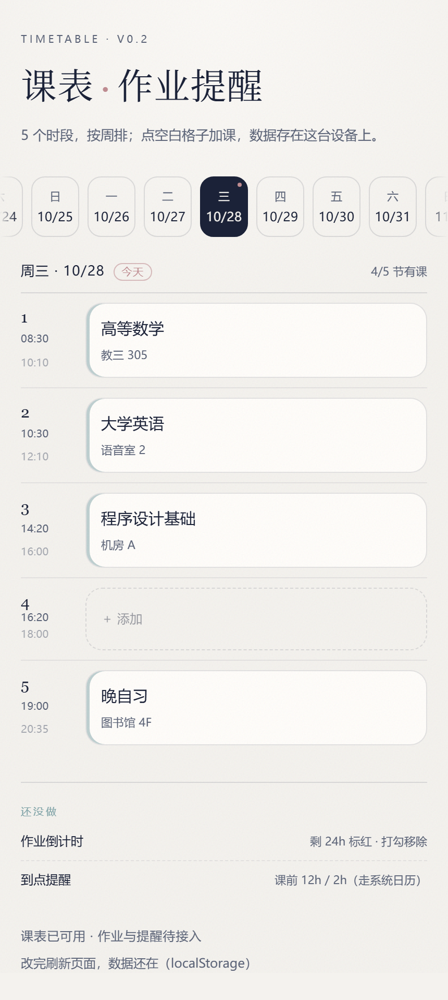

# 课表 · 作业提醒（timetable-react）

大一第一个正式项目。目标：手机上打开的课表 + 作业倒计时，给一个宿舍四个人用。

- **项目状态**：v0.3 —— **课表能用，而且已经是你自己的真实课表**（11 门课），作业倒计时和提醒还没做
- **技术栈**：Vite 7.3.7 + React 19.3.1，纯前端，无后端
- **路径**：`E:\code\timetable-react`

## 怎么跑起来

方式一（最省事）：双击 `启动网页版.cmd`，会自动开浏览器。
方式二（命令行）：

```powershell
cd E:\code\timetable-react
npm install      # 第一次才需要，装依赖
npm run dev      # 起开发服务器，地址 http://127.0.0.1:5173/
```

第一次在新电脑上跑，如果提示 `node_modules\vite\bin\vite.js` 找不到，先双击 `安装依赖.cmd`。

## 版本管理（git 已装好）

这台机器上刚装的是**便携版 Git 2.56**（免管理员权限），路径 `C:\Users\hha super jiaolong\AppData\Local\Programs\Git`，`cmd` 已在用户 PATH 里。**装完要重开一次终端/编辑器**，`git --version` 才认得。

项目已经初始化成仓库，第一个提交是 `v0.2 课表版块可用`。以后每次改完想存档：

```powershell
cd E:\code\timetable-react
git status            # 看改了哪些文件
git add -A            # 把改动放进暂存区
git commit -m "说明这次做了什么"
git log --oneline     # 看历史（按 q 退出）
```

## 目录说明（只看这五个文件就够了）

| 文件 | 作用 | 什么时候改它 |
| --- | --- | --- |
| `index.html` | 页面外壳，只有 `<div id="root">` | 基本不改 |
| `src/main.jsx` | 入口：把 `<App />` 挂到 root 上 | 基本不改 |
| `src/App.jsx` | **主文件**：页面结构、组件、以后的数据逻辑 | 90% 的活在这 |
| `src/data/timetable.js` | **你的真实课表**：11 门课 + 5 大节默认作息 | 换课、调作息 |
| `src/styles.css` | 全部样式，颜色都写成 `--变量`，集中在 `:root` | 换配色、调字号 |
| `vite.config.js` | 开发服务器配置（`host: true` 让手机能访问） | 部署前加 `base` |

`node_modules` 是依赖包，别手改、别提交；`dist` 是 `npm run build` 的产物，也是自动生成的。

## 课表数据是怎么来的

`src/data/timetable.js` 里这 11 门课，是从「课表查询」App 的截图（2026-2027-1 第十周，11/2 那一周）里**一格一格量出来的**：先按像素找表格的 5 条竖线定出「星期几」，再按大节的纵坐标切出每个有课的格子，最后逐格识别文字。

键名规则是 `星期几-大节号`，`'2-1'` 就是周二第 1 大节。大节和学校小节的关系：**大节1=第1-2小节、大节2=3-4、大节3=5-6、大节4=7-8、大节5=9-10**。

三处「高等数学(1)机电」的教室在截图里被截断成 `弘远楼B0…`，代码先照原样存着，界面上会显示「待补」——点开那一格改成完整房号就存下来了。

## 现在页面上有什么



**已经能用**：5 个大节 × 周一到周日。顶上一排日期可以左右滑，默认停在「今天」；**你自己的 11 门课已经导进来了**，同课同色；点格子改课（课程名 + 地点），点左边的时间列改这一节的作息；点已有的课可以改或删。数据存在浏览器 localStorage，**关掉再开、刷新都不会丢**（换浏览器/清缓存才会丢）。

几个小细节：

- 「今天」那格右上角有个小圆点，正在上的那节课会用灰玫瑰色描边。
- 页面每 60 秒自己重算一次「现在第几节」，不用刷新。
- 地点沾上「待补」的，就是截图里被截断的那几个房号，点进去补完就消失。
- 数据只存在这台设备上，另一台手机打开是空的——多设备同步要等以后加后端。

**还没有**：作业倒计时、到点提醒（页面底部「还没做」那两块就是提醒你这两件事还没写）。

## 改代码前先知道的三个坑

1. **`Date` 会偷偷改月份**：`new Date(2026, 9, 31).setDate(32)` 看起来很怪，所以代码里统一用 `addDays()` 包装，别直接改 `getDate()`。
2. **JS 的 `getDay()` 是 0=周日**：页面要「周一=1」，所以有个 `isoWeekday()` 做换算，别混用。
3. **localStorage 里存的是字符串**：存之前 `JSON.stringify`，读的时候要 `try/catch` 兜住（用户可能手改坏），代码里 `loadCourses()` 就是这么写的。

## 下一步（按顺序，别跳）

1. ~~课表：5 个固定时段 + 星期几，能按天切换~~ ✅
2. ~~数据落地：localStorage~~ ✅
3. ~~导入真实课表（11 门课，从 App 截图一格一格量出来）~~ ✅
4. 作业：名字 + 截止时间 + 倒计时，剩 24 小时标红
5. 打勾：停表并从列表移除
6. 提醒：见 `docs/立项卡.md` 里关于「浏览器提醒的真实限制」那一段
7. 上线 + 装到手机桌面（PWA）

## 踩过的坑

- **`npm install` 会报一条 `install-scripts` 警告（esbuild）**：不影响使用，构建已验证通过，忽略即可。
- **5173 端口被占**：另一个 dev 服务器还在跑，关掉旧窗口，或看终端给出的新端口（5174…）。
- **中文路径 / 带空格的路径**：这个项目路径是纯英文的，别挪到中文目录里去。
- 老项目 `E:\code\timetable`（纯 JS 版）还在，两个项目的端口都是 5173，**同时只能跑一个**。
